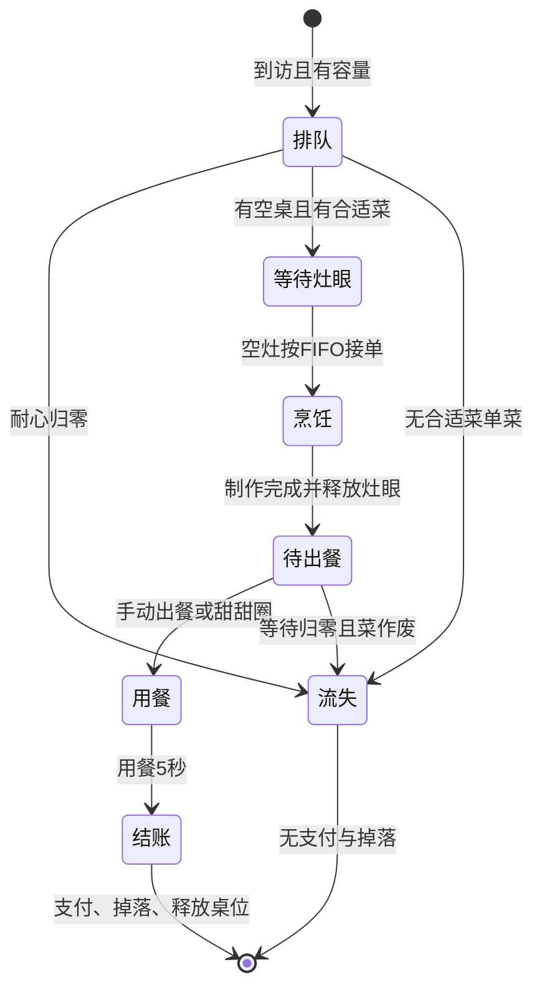
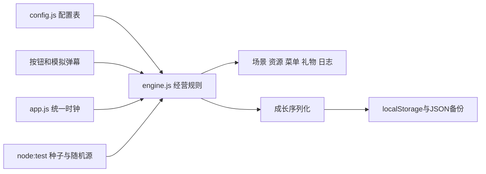

# 百味饭馆设计与工程说明

目标是满足简版 24 小时作业的 T01–T14，而不是复刻参考图中的多人完整产品。页面以斜俯视街边饭馆为主场景，桌位分布在通道两侧，上方候客区、下方厨房，中间保留通道。固定9:16主场景铺满画布，顶部五种礼物可免费模拟，外围入口打开菜谱、成长、客人、总览和见闻页面。管理页继续营业，底部保留直接出餐入口。

## 状态机

容量满时新客人不进入状态数组，只累计到访和容量流失。客人实体维护 `id/type/state/table/dish/remaining`，烹饪订单补充 `started/duration/wands`，成品补充 `readyAt`。灶眼、待出餐区和排队区都是由状态派生的视图，避免重复列表出现孤儿订单。

## 模块

`engine.js` 可在浏览器或 Node 中独立运行，不访问 DOM、计时器或存储。`Game.step(n)` 只接收非负整数秒；其结果可以无界面测试。所有礼物、研发、上下架和升级调用引擎方法，方法返回 `{ok,message}`；失败也留下可见日志。

`app.js` 使用一个 requestAnimationFrame 驱动累计时间，每达到一秒调用一次 Tick；没有客人、订单或礼物专用定时器。toast 的现实时间只用于界面显示，不改变游戏状态。切后台、暂停和说明弹窗打开时清空尚未完成的时间片，避免返回后突然跳过规则。模拟时间由本地单调时钟推进，存档不计算现实时间差。

## Tick 内顺序

1. 模拟时间加 1；若自动出餐有效，端走已有待出餐菜。
2. 对 Tick 开始时存在的客人推进时间，分别处理排队流失、烹饪完成、出餐超时、用餐结账。刚完成菜在同 Tick 即可自动出餐，但不会重复推进这道新状态。
3. 依序落座、匹配菜、给空灶分配最早订单。
4. 累加自然客流进度，处理本 Tick 应到访的新客人。
5. 统一扣减魔法镜、甜甜圈、炸弹时间。最后有效 Tick 按尚未到期处理，归零后移除效果。

菜单变更影响之后的点单；已点单订单不撤销。饭馆升级立即增加容量、接纳队列和空灶调度；厨师升级按比例改变在制订单。

## 存档和异常

保存对象有明确版本。加载时清洗非有限和负数资源、非法菜品 ID、重复上架和越界等级，厨师不超过饭馆等级。src/storage.js先检查存档版本与结构，损坏JSON、版本不兼容或结构异常时保留原始字符串、不覆盖原记录；设置中可原样导出备份或导入有效存档。对 localStorage 异常有降级反馈，游戏仍运行。

实验室保留正式 Game 实例，使用新 Game 实例进行实验。实验期间 `persist()` 不写存档，返回时恢复原对象。刷新从正式存档重建；实验奖励不会进入正式资源。

## 素材、视觉与音频边界

`presentation.js` 使用带实体key的DOM更新器，保留客人、桌位和礼物按钮节点。每次Tick捕获状态转换与新日志，在统一渲染后播放移动、端菜、收入和礼物特效。视觉日志使用对象身份去重，视觉粒子用固定位置与颜色，不消耗游戏随机源。动效完成/取消仅清理展示节点，不触发经营动作。

`audio.js` 缓存离线PCM解码，管理一个音乐循环、一个烹饪循环和限量短音效。媒体设置单独持久化。暂停与系统减少动态直接控制展示层，不改变引擎状态机、速度倍率或礼物数值。

## 可扩展点

新增菜品或客人主要改配置表；新增等级还需扩展成长上限与场景桌位坐标。礼物接口可以接收外部消息，但本作业只使用本地按钮/弹幕，不提供真实平台 SDK。后续若接网络，应以服务器权威状态替代本地 tick 与存档，并对消息做幂等校验。
